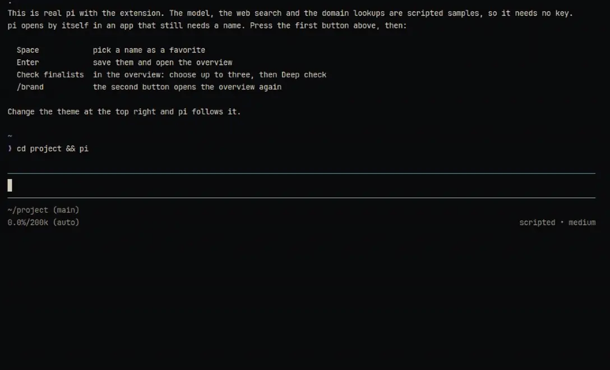

# pi-brand

Name your product inside the [pi coding agent](https://pi.dev). The model proposes ranked names, you pick favorites in a keyboard picker, and pi-brand checks whether your finalists are taken: a web search, a domain lookup, and a short verdict with sources. None of it grows your main conversation.

**[Try it in your browser](https://pi-brand.soleone.xyz)**: real pi with the extension, on a scripted model with sample search results, so no key and nothing leaves the page.



## Install

```sh
pi install git:https://github.com/Soleone/pi-brand
```

Requires pi **0.99.1 or newer** for nested tools and provider-neutral model requests. After updating, run `/reload`. Checks use the `web_search` tool, so enable a web search extension before running one.

## How it works

1. `/brand <what the product does>` generates a ranked pool in an isolated model request, then opens the favorites picker.
2. **Space** toggles, **↑↓** moves, typing filters. **Enter** saves favorites. **Esc** opens a reject/note prompt; Esc again cancels the batch.
3. Picker actions:
   - **0**: save checked favorites and return to the overview, reserving unpicked names rather than rejecting them
   - **1**: another batch, using the reserve first
   - **2**: update the direction and get new names
   - **3**: choose up to three finalists, then check them
   - **4**: save the highlighted name as a favorite and get more like it
4. `/brand finalists` promotes up to three favorites. Older favorites remain taste references, not a research queue. The finalist picker shows newest favorites first; Space toggles, Enter saves, Esc cancels.
5. `/brand check` checks only finalists. `/brand evidence <name>` shows retained findings and source links.
6. Once a product brief exists, **`/brand`**, `/brand overview`, and `/brand status` open the overview without generating. Saving, rejecting or cancelling a favorites round also returns there.

The overview shows favorites, finalists and their cached-check status, reserve, seen/excluded count, direction, and both model roles. Browse all favorites, choose finalists, inspect evidence/history, edit the brief, change models, or continue naming. The favorites list shows each item's status and has a cache-first **Check all favorites** action. It checks in batches of three; selecting one favorite offers individual deep/quick checks and explicit refreshes, without changing finalists. Terminal lists are searchable and show at most ten entries at a time. Esc backs out of subviews; Esc in the overview returns to chat. RPC uses supported select/input dialogs for the same actions.

You do not have to generate more names to finish shortlisting. With many favorites, go straight to **Choose finalists**. See [UI navigation and boundaries](docs/ui-navigation.md) for the complete flow and remaining command-only operations.

Default exploration makes **no network availability checks**. `/brand screen` explicitly requests a quick web screen of finalists. `/brand screened` opts into screening **three candidates before display**, three at a time rather than researching an entire speculative pool. Screened mode can add up to 45 seconds after generation.

## Budgets and models

`/brand-settings` picks a **creative** model for names and an optional cheaper **worker** model for judging search evidence. Both are saved with this project's run and never switch your main session model. The default creative model is `openai/gpt-6-luna`.

Every request is single-turn and isolated: it sees a compact brief, a few of your favorites as taste examples and a sample of excluded names, never the conversation. A batch is at most two requests and 24 names; you see 12 and the rest wait in a reserve, so **More** is often free. Checks run three names at a time within 45 seconds. `/brand stats` shows time, tokens and cost per batch.

Exact limits, timeouts and how prompt caching is (and isn't) used are in [docs/budgets-and-caching.md](docs/budgets-and-caching.md).

## One current brief

`/brand brief` shows the current product, direction, constraints and both model roles. Historical direction notes are retained but no longer replayed. `/brand note` and `/brand pivot` replace the current direction instead of stacking contradictory instructions.

Defaults: familiar single words, up to 12 characters, inspect `.com` and `.app`, package/handle checks off.

```text
/brand note familiar, energetic English words
/brand words single
/brand words multiple
/brand length 10
/brand domains com dev
/brand packages on
```

Package and repository checks are opt-in because a consumer app need not have an unused npm name. Changing check requirements retains existing cached findings; request a refresh explicitly if needed.

## Evidence, not legal clearance

Results use `perfect / good / decent / bad / terrible`, plus **unknown** when evidence is incomplete. They describe the checks performed, not trademark clearance. Missing signals never count as a clean result, and a strong unrelated brand is kept apart from a same-category collision.

Each result keeps its reasons, source URLs, short excerpts and timestamps; `/brand evidence <name>` shows them. Deep checks add domain registry lookups and, if enabled, npm and GitHub. A registry 404 means **no record found**, not that a domain is registrable or affordable. Results are cached until you refresh them (`/brand check refresh`), and a quick screen upgrades to a deep check without searching again.

Search runs through pi's `web_search` tool and its permission hooks. Raw results and speculative names never enter the main conversation.

## Storage

Each project gets its own run file at `$DATA/apps/pi-brand/runs/`, falling back to `$XDG_DATA_HOME/pi-brand/runs/` or `~/.local/share/pi-brand/runs/`. `PI_BRAND_CONFIG` overrides the path, and `/brand stats` shows it. Writes are atomic and private. Older `.pi/brand.json` files are imported once with a backup; details in [docs/storage.md](docs/storage.md).

## Commands

```text
/brand                    overview when a brief exists; otherwise start a run
/brand overview|status    overview without generation
/brand <description>      generate and pick favorites
/brand more              next reserve batch or bounded generation
/brand pivot <note>       new direction, then generate
/brand note <note>        update direction only
/brand likes             favorites and finalists
/brand finalists [names]  choose at most three favorites
/brand check [refresh]    deeper finalist checks
/brand check <name>       show one cached result
/brand screen [refresh]   quick finalist web screen
/brand screened          screen three names before display
/brand evidence <name>    retained findings and source links
/brand brief             current brief and model
/brand-settings          choose creative and worker models for this project
/brand settings          same settings menu
/brand model <provider/id>
/brand worker <provider/id|same>
/brand words single|multiple
/brand length <3-30>
/brand domains <suffixes>
/brand packages on|off
/brand stats             path, reserve and generation metrics
/brand keep <names>      save favorites from a recorded batch
/brand dismiss <names>   exclude names; remove from favorites and finalists
/brand excluded          complete seen/excluded name list
/brand history           recorded candidates, reserve, dismissals and direction notes
/brand clear             confirm clearing this run; backup remains
/brand help
```

Separate multiple names with commas, especially multiword names. Print/JSON mode saves candidate batches; use `keep` and `finalists` to select without the terminal picker. RPC uses select dialogs, not terminal components.

Compatibility tools `brand_pick`, `brand_score` and `brand_seen` remain available. The owned workflow uses `brand_generate` and `brand_check`; callers no longer need per-name cache choreography. `brand_score` supports a batch `names` lookup. Manual legacy signal recording remains supported without manufacturing missing signals.

## Development

```sh
npm install --ignore-scripts
npm run check
npm test
npm run validate
```

Tests are offline and use fake model, search and fetch responses. Live model quality and provider latency still need a real naming run.

`npm run demo` serves the browser demo locally, and `npm run media:capture` re-records the loop and hero.

Public headless seams: `pi-brand/generation`, `pi-brand/engine`, `pi-brand/checker`, `pi-brand/store`. They take explicit state and request adapters, so a future CLI or browser interface can reuse the workflow instead of replacing it.
