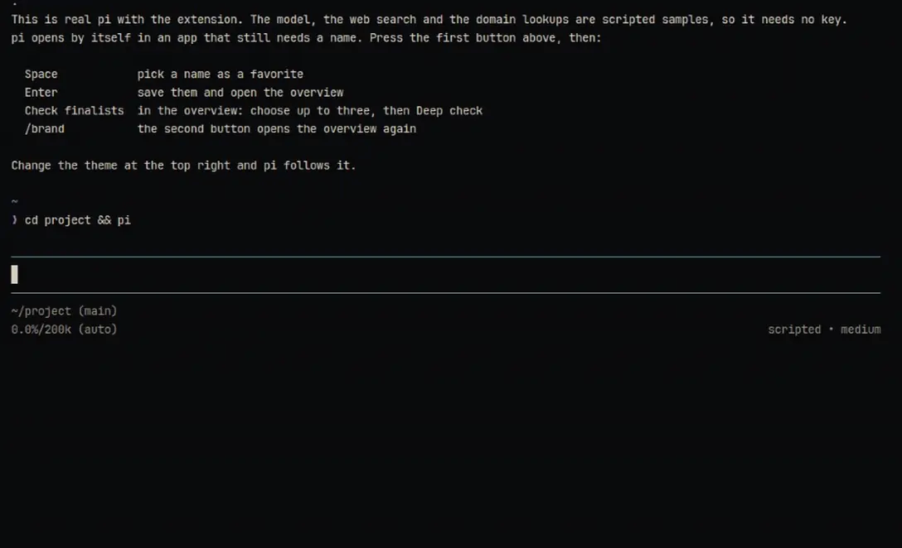

# pi-brand

Name your product inside the [pi coding agent](https://pi.dev). Explore names in a keyboard workspace, refine an editable brief with feedback, and check the favorites worth pursuing.

**[Try it in your browser](https://pi-brand.soleone.xyz)**: real pi with scripted names and sample research. No API key; nothing leaves the page.



## Install

```sh
pi install git:https://github.com/Soleone/pi-brand
```

Requires pi **0.99.1 or newer**. After updating, run `/reload`. Availability checks need the `web_search` tool.

## The everyday loop

1. `/brand <what the product does>` generates names from your saved brief.
2. Generated names join the active list as **Selected**. **Space** marks rows for bulk actions; **a** marks all filtered rows. **f** toggles Favorite on the highlighted or marked names. **Enter** opens details.
3. **Tab or ←/→** switches **Names / Favorites / History**. Navigation never starts model work. **/** searches names.
4. **g** prepares generation: see whether the next batch uses the reserve or a new model call, then explicitly start with Enter.
5. **n** adds your own name to the list and focuses it. **Enter**, then **c**, checks just that name. Adding alone does no research or favoriting.
6. **b** reveals the otherwise hidden brief. **e** edits it; **f** gives AI-interpreted feedback. Feedback returns to browsing, not automatic generation.
6. `/brand` resumes without generating. Name details expose evidence, direct check actions and similar-name refinement. Check shortcuts start immediately; no finalist promotion is needed.

**New → Selected → Favorite** is the naming lifecycle; bulk checkboxes are separate. New is transient during generation, Selected means membership in the active list, and Favorite is a starred active name. **d** discards highlighted/marked names after confirmation. Discarded names leave the active list but remain in History and duplicate exclusions. Closing never deletes or rewrites a round. **More like this** (`m` in name details) prepares a brief refinement without silently favoriting the reference.

## Your brief and feedback

The canonical brief is an editable Markdown document with six sections: **Product, Explore, Avoid, Style, Examples, Format**. `/brand brief edit` opens the whole document. You can also edit it directly; `/brand stats` shows its path.

Feedback makes targeted changes instead of replacing the entire direction. For example, “HQ could work too, e.g. TaskHQ” can add HQ constructions while keeping a control-center direction and existing avoidances. Your original words and the actual before/after interpretation are retained separately. Short acknowledgements show what changed; full changes remain in feedback history.

- `/brand feedback <comment>` updates the brief without generating.
- `/brand pivot <comment>` updates it, then generates.
- `/brand history` opens the editable feedback document. Annotate or correct the record there; edit the **brief** to change what applies now.
- Favorites are positive taste examples alongside explicit brief examples. The brief takes priority. Other selected names and discarded history are not taste instructions.
- Single-word format means one token, not dictionary-only. Compounds and abbreviations such as TaskHQ are allowed unless your brief excludes them. Names use letters, plus spaces when multiple words are enabled.

Historical notes are preserved but not blindly replayed. Imported notes are labeled with unknown original author/date rather than attributed to you. Invalid documents fail with an error; they are never silently replaced.

## No mystery rounds

Each generated pool retains its brief revision, effective inputs, explicit examples, model, system prompt, exact request prompts (including a refill), and original candidates. `/brand round [id]` or **b → i** inspects them. Old rounds without recorded inputs say so instead of inventing provenance.

The generation preparation screen distinguishes **new generation** from **remaining names from a previous pool**. Brief, favorite or creative-model changes invalidate old reserves. Generating uses single-turn isolated requests, not your main conversation. Inspection only brings the requested context into chat.

Default naming does **no availability research**. See [budgets and caching](docs/budgets-and-caching.md) for request limits, costs, and the optional screened mode.

## Check names when ready

**c Check pending** immediately checks every unassessed or inconclusive (**unknown**) name in the current filtered list, so an inconclusive result is not stuck. With bulk marks, it checks marked names instead, reusing conclusive assessments and retrying unknowns. **Shift+C Recheck all** forces fresh checks of the list, or marked names, with the current worker model. There is no extra confirmation screen; progress appears while checks run in batches of three. The list returns automatically with updated results, preserving your tab, filter, cursor and marks. Checking never promotes names to favorites.

Name details also expose individual checks, refresh and quick screen. `/brand check <name>, <name>` checks up to three saved names; `/brand check all` checks pending active names (unassessed or unknown); `/brand check all refresh` rechecks the active list. Failed refreshes retain previous assessments.

Results use `perfect / good / decent / bad / terrible`, or **unknown** when evidence is incomplete. They retain reasons, URLs, excerpts, and timestamps. `/brand evidence <name>` shows them. These are preliminary collision findings, **not trademark clearance**. A registry “no record found” is not a promise that a domain is registrable or affordable.

## Storage stays outside your project

Default location:

```text
$DATA/apps/pi-brand/runs/<project>-<path-hash>.json
$DATA/apps/pi-brand/runs/<project>-<path-hash>.brief.md
$DATA/apps/pi-brand/runs/<project>-<path-hash>.feedback.md
```

Without `$DATA`, use `$XDG_DATA_HOME/pi-brand/runs/` or `~/.local/share/pi-brand/runs/`. `PI_BRAND_CONFIG` can override the JSON path, but **project-local paths are rejected**, including symlink escapes. All documents remain beside the external run file. No new `.pi/brand.json` or other run data is written into the project.

Existing runs migrate with an external backup, preserving favorites, rounds, cached evidence, and historical notes. Untraced old reserves are cleared rather than presented as fresh results. See [storage and migration](docs/storage.md).

## Commands and settings

The workspace covers normal use. Command equivalents:

```text
/brand                   resume the workspace
/brand <description>     start naming
/brand more              continue the pool or generate
/brand feedback <text>   interpret feedback; show brief changes
/brand pivot <text>      apply feedback and generate
/brand brief [edit]      inspect/edit the naming document
/brand history           inspect/annotate feedback history
/brand round [id]        inspect actual saved generation inputs
/brand check [names]     select/check saved names
/brand check all         check pending active names (unassessed or unknown)
/brand check all refresh recheck all active names
/brand evidence <name>   read retained findings
/brand settings          choose creative and optional worker models
/brand stats             document paths and generation metrics
/brand help              advanced commands and compatibility aliases
```

Separate multiple names with commas. Models, domain suffixes, and optional npm/GitHub checks live under **b → s (Settings)**. These settings never change your main session model. Existing `note`, `finalists`, word/length controls, quick screens, and manual keep/dismiss commands remain compatible; finalist selection is optional, not the main flow.

Chat tools are `brand_context`, `brand_feedback`, `brand_generate`, and `brand_check`. Compatibility tools `brand_pick`, `brand_score`, and `brand_seen` remain callable through codemode rather than cluttering the main tool list.

[UI navigation](docs/ui-navigation.md) covers terminal, RPC, and non-interactive behavior.

## Development

```sh
npm install --ignore-scripts
npm run check
npm test
npm run validate
```

Tests use fake models, search, and fetch responses. Live naming quality and provider latency still need real runs. `npm run demo` serves the scripted browser demo; `npm run media:capture` records it.

Public headless seams: `pi-brand/generation`, `pi-brand/engine`, `pi-brand/checker`, `pi-brand/store`.
